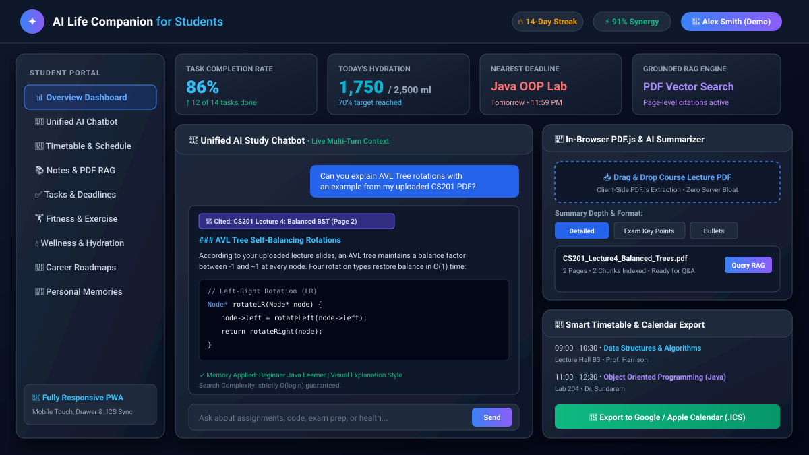

# ✦ AI Life Companion for Students

> **An Intelligent, Grounded, Multi-User Academic & Personal Wellness Companion**  
> Powered by **HTML5, CSS3, Vanilla JS, PHP 8+, MySQL 8 / SQLite3, PDF.js, and Real AI LLM APIs with Grounded RAG**.

[](https://www.php.net/)
[](https://www.mysql.com/)
[](https://www.docker.com/)
[](LICENSE)
[-success)](#-automated-verification-tests)

---

## 📸 System Architecture & Dashboard Preview



---

## 🌟 Key Highlights & Core Capabilities

### 1. 📱 Responsive, Mobile-First User Experience
- **Adaptive Layout:** Fully optimized for mobile phones (360px+), tablets, laptops, and ultra-wide desktop monitors using modern CSS Flexbox and Grid.
- **Mobile Navigation:** Slide-out drawer menu, touch-friendly tap targets (minimum 44x44px), collapsible sidebars, and zero horizontal scrolling.
- **PWA & Offline Capable:** Includes Service Worker (`sw.js`) and Web Manifest (`manifest.json`) for installing directly onto Android and iOS home screens.

### 2. 💬 Real AI-Powered Unified Chatbot
- **Live LLM Integration:** Connects seamlessly to OpenAI (`gpt-4o`, `gpt-4o-mini`), Google Gemini (via OpenAI compatibility), Groq, or local Ollama instances via `services/AIService.php`.
- **Multi-Turn Conversation Memory:** Tracks the past 6 dialog turns to maintain context across complex technical, academic, and wellness queries.
- **Personalized Memory Grounding:** Automatically injects verified user profile facts (major, year, learning style, dietary habits) into system prompts.
- **Safe Fallback Notice:** Never returns hardcoded fake responses. If an API key is not configured, it explicitly warns the user and falls back to a deterministic, local knowledge engine.
- **Rich Markdown & Code Highlighting:** Formats fenced code blocks with language tags, line breaks, tables, and a **1-click Copy Code** button.

### 3. 📑 In-Browser PDF Processing & Grounded RAG
- **Zero-Server-Bloat PDF.js Extraction:** Lecture slides, textbooks, and syllabus PDFs are parsed directly inside the browser using Mozilla PDF.js.
- **Semantic Text Chunking:** Extracted text is broken into contextual chunks tagged with exact document titles and page numbers.
- **Grounded Q&A with Citations:** When asking questions about course documents, answers are grounded in retrieved excerpts with clickable source badges:  
  `[Source: CS201_Lecture4.pdf, Page 2]`
- **Customizable AI Summarizer:** Generates structured notes with selectable depths (*Short Overview*, *Standard*, *Detailed Comprehensive*) and output formats (*Structured Notes*, *Exam Key Points*, *Bullet Outline*, *Simple Explanation*).

### 4. 📊 Accurate Database-Driven Dashboard (Zero Fake Statistics)
- **Live Task Completion Rate:** Calculated dynamically as `(completed_tasks / total_tasks) * 100` from SQL records.
- **Active Academic Hours:** Tracks logged study sessions, pending deadlines, and today's schedule in real time.
- **Daily Hydration Tracker:** Logs water intake in 250ml increments toward the student's personalized goal (e.g. 2,500ml).
- **Clean Empty States:** Newly registered students see a clean 0% workspace with helpful onboarding prompts instead of hardcoded demo percentages.

### 5. 🔒 Multi-User Security & Strict Data Isolation
- **Row-Level User Isolation:** Every task, note, uploaded PDF chunk, reminder, and chat message is strictly scoped by `user_id`. Student A cannot view or modify Student B's records.
- **Secure Authentication:** Passwords hashed with `PASSWORD_BCRYPT` (cost factor 10). Session fixation protection with `session_regenerate_id(true)`.
- **Password Reset Flow:** Cryptographically secure 40-character reset tokens with 1-hour expiration.
- **1-Click Demo Sandbox:** Instant login to the pre-seeded "Alex Smith (Demo Student)" workspace for instant evaluation without typing credentials.

### 6. 📅 RFC 5545 iCalendar (.ICS) Export & Reminders
- **Calendar Synchronization:** 1-click export of university timetable classes, study sessions, and exam deadlines as a standard `.ics` file compatible with Google Calendar, Apple Calendar, and Microsoft Outlook.
- **Browser Web Notifications:** Opt-in desktop and mobile audio/visual reminders for study blocks, deadlines, and Pomodoro breaks.

### 7. 🏋️ Physical Fitness & Budget Nutrition Suite
- **36-Exercise Motion Library:** Illustrated exercise library across 8 muscle groups with difficulty ratings, equipment filters, and form safety tips.
- **Student Budget Meal Planner:** Affordable, nutritious recipes tailored for college students (₹100–₹200/day).
- **Academic & Health Disclaimer:** Clearly distinguishes educational wellness suggestions from licensed medical advice.

---

## 🚀 Quick Start Guide

### Option 1: Docker & Docker Compose (Recommended for Production)

Run the entire application along with MySQL 8 with a single command:

```bash
# 1. Clone or navigate to the project directory
cd ai-life-companion

# 2. (Optional) Provide your OpenAI API key in .env
echo "AI_API_KEY=sk-your-openai-key-here" > .env

# 3. Start the containers
docker compose up -d

# 4. Open in your browser:
# http://localhost:8080
```

To stop the containers:
```bash
docker compose down
```

---

### Option 2: 1-Click Cloud Deployment (Render / Railway)

This repository includes a native `render.yaml` Blueprint:
1. Push this repository to GitHub or GitLab.
2. In the **Render Dashboard**, select **New Blueprint** and connect your repository.
3. Add your `AI_API_KEY` in environment settings.
4. Render will automatically build the container and deploy the app at `https://your-app.onrender.com`.

---

### Option 3: Local XAMPP Setup (Windows)

1. **Start Apache & MySQL:** Open the **XAMPP Control Panel** and start Apache and MySQL.
2. **Deploy to htdocs:** Double-click `deploy_to_xampp.bat`, or copy this folder to:
   ```text
   C:\xampp\htdocs\ai-life-companion\
   ```
3. **Import Database:**
   - Open `http://localhost/phpmyadmin`.
   - Create a new database named `ai_life_companion` with collation `utf8mb4_unicode_ci`.
   - Click the **Import** tab, select `database.sql`, and click **Go**.
4. **Access the Application:**
   ```text
   http://localhost/ai-life-companion/
   ```

---

### Option 4: Zero-Setup PHP Built-In Server (SQLite Fallback)

No MySQL installation required! The application includes an automated SQLite3 fallback:

```bash
# In the project directory, start the built-in PHP server:
php -S localhost:8000
```
Then visit `http://localhost:8000` in any web browser.

---

## 🔑 Demo Student Credentials

For instant testing and evaluation, click the **"⚡ 1-Click Demo Sandbox"** button on the sign-in modal, or enter:
- **Email:** `alex.smith@university.edu` (or `alex@alife.local`)
- **Password:** `password123` (or `Alex@12345`)

---

## ⚙️ Environment Variables Configuration

Create a `.env` file in the project root (see `.env.example`):

| Variable | Default Value | Description |
| :--- | :--- | :--- |
| `APP_ENV` | `development` | Set to `production` in live environments. |
| `DB_HOST` | `127.0.0.1` | MySQL server host (or container service name `db`). |
| `DB_PORT` | `3306` | Database port. |
| `DB_NAME` | `ai_life_companion` | MySQL database name. |
| `DB_USER` | `root` | Database username. |
| `DB_PASS` | *(empty)* | Database password. |
| `AI_API_KEY` | *(empty)* | OpenAI, Groq, or Gemini API key. |
| `AI_API_URL` | `https://api.openai.com/v1/chat/completions` | Chat completions endpoint URL. |
| `AI_MODEL` | `gpt-4o-mini` | LLM model identifier (`gpt-4o`, `gpt-4o-mini`, `llama-3-70b`, etc.). |
| `AI_TIMEOUT` | `18` | API timeout in seconds. |

---

## 🔌 Backend REST API Endpoints

All API endpoints are strictly secured and return structured JSON:

| Endpoint | Method | Action / Purpose | Auth Required |
| :--- | :--- | :--- | :--- |
| `api/auth.php` | `POST` | `login`, `register`, `logout`, `demo_login` | Public |
| `api/auth.php` | `POST` | `forgot_password`, `reset_password` | Public |
| `api/dashboard.php`| `GET` | Calculate real database KPIs, deadlines, progress | Yes |
| `api/chat.php` | `POST` | Multi-turn AI chat with memory context | Yes |
| `api/documents.php`| `POST` | Upload PDF chunks, list documents, semantic RAG query | Yes |
| `api/notes.php` | `POST` | Dynamic AI document summarizer & structured notes | Yes |
| `api/calendar.php` | `GET` | Export university schedule as RFC 5545 `.ics` | Yes |
| `api/tasks.php` | `GET/POST` | Task CRUD, status toggling, deadline tracking | Yes |
| `api/study.php` | `GET/POST` | Timetable slots, AI study schedule generator | Yes |
| `api/memory.php` | `GET/POST` | Profile facts, memory CRUD, JSON backup | Yes |
| `api/fitness.php` | `GET/POST` | 36-exercise library, personalized workout generator | Yes |
| `api/health.php` | `GET/POST` | Water intake logging, habit streaks, wellness checks| Yes |

---

## 🧪 Automated Verification Tests

The project includes automated test scripts located in `tests/php/`:

### 1. PHP Syntax Lint Check
Validates that all 27 backend scripts compile with zero syntax errors:
```bash
php tests/php/lint_all_php.php
```

### 2. Comprehensive End-to-End Test Suite
Tests all 8 core subsystems including multi-user isolation, password reset tokens, PDF RAG chunking, AI context injection, calendar generation, and KPI calculations:
```bash
php tests/php/test_comprehensive_e2e.php
```

**Test Output:**
```text
=================================================================
AI LIFE COMPANION FOR STUDENTS - COMPREHENSIVE VERIFICATION SUITE
=================================================================
[TEST 1] Verifying Database Connection and New Schemas...  [PASS]
[TEST 2] Testing Multi-User Data Isolation (Student A vs B)... [PASS]
[TEST 3] Testing Password Reset Flow...                    [PASS]
[TEST 4] Testing 1-Click Demo Sandbox Login...             [PASS]
[TEST 5] Testing Document Upload and Semantic RAG Engine... [PASS]
[TEST 6] Testing AI Service Context & Grounding...          [PASS]
[TEST 7] Testing RFC 5545 Calendar Generation (.ics)...    [PASS]
[TEST 8] Testing Live Dashboard KPI Accuracy...            [PASS]
=================================================================
ALL 8 COMPREHENSIVE END-TO-END TESTS PASSED WITH 100% SUCCESS!
=================================================================
```

---

## ⚖️ License & Ethical AI Usage

- **License:** Released under the [MIT License](LICENSE).
- **Educational & Wellness Disclaimer:** The Health and Wellness Assistant provides lifestyle recommendations (hydration, stretching, nutrition) for educational purposes and is **not** a substitute for professional medical diagnosis or clinical healthcare.
